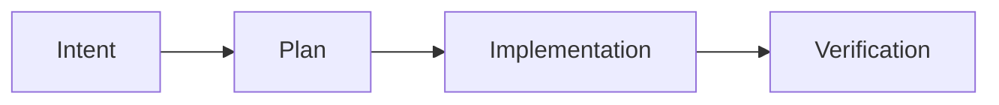
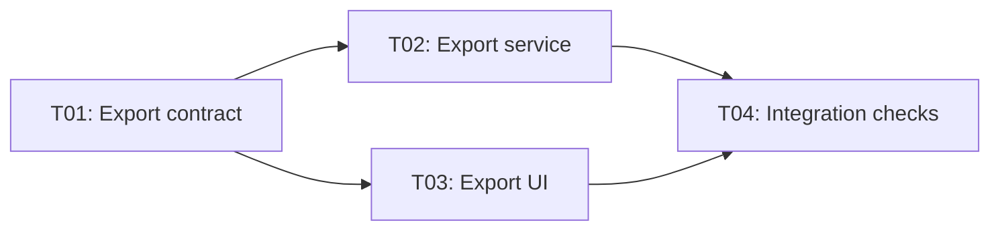

# SpecFlow

**SpecFlow is a skill-first development protocol for coding agents.**

[中文说明](README.zh-CN.md)

SpecFlow gives coding agents a reviewable process for software changes: clarify intent, plan the work, implement it, and verify the result. The agent performs the development work; SpecFlow defines the documents, stage boundaries, and coordination rules.

## Workflow

Every task follows the same four stages:



Complexity determines whether to add task documents. A small change keeps an Intent, a Plan, and a Verification record, with concise content. Larger work shares those parent documents and adds one `task` document per subtask. Technical design belongs in the plan or the relevant task.

The agent assesses deliverables, affected responsibilities, unknowns, checks, review context, and coordination costs. Each subtask should have one main result, a clear scope, and checkable acceptance criteria. File counts, line counts, and estimates are signals, not universal splitting thresholds. A small but risky change may need deeper design and checks; an unresolved design choice may justify an investigation task first.

## Install

Development from a checkout requires Python 3.12+, `uv`, GNU Make, and bash. On Windows, use an environment such as Cygwin that provides Make and bash.

Sync the locked development dependencies:

```bash
make deps
```

Install the editable CLI in the user tool directory and synchronize the native plugin:

```bash
make install
```

The native plugin contains the skill, templates, and coordination reference under `plugins/specflow/skills/specflow/`. The `install` target checks and synchronizes the plugin through the local Claude Code, Codex, or Grok Build plugin mechanism.

You can also install the CLI from a built wheel. Replace the path and version with your actual wheel:

```bash
uv tool install "/path/to/specflow-<version>-py3-none-any.whl"
```

The wheel includes the CLI's five document templates. Native agent plugin synchronization is handled separately by the repository's `make install` target.

## Use

Start with the [coding-agent skill](plugins/specflow/skills/specflow/SKILL.md), such as `/specflow` in Claude Code. Use natural language to describe the change and the stage you want to enter.

### Clarify and plan

Discuss the goal, constraints, examples, and edge cases. When ready, start Intent:

```text
Use /specflow: add report export. Start Intent and assess whether the work needs task decomposition.
```

The agent records the intent, workload assessment, and any candidate tasks or dependencies. It highlights assumptions, risks, and open questions. A request to start Intent produces an intent draft for review; later stages follow your authorization.

Accept the intent and start Plan:

```text
Accepted, start Plan.
```

The plan records technical decisions, implementation steps, affected files, and checks. For split work, the coordinating conversation also creates the task documents, dependency graph (DAG), task definition table, and execution registry. The plan becomes the authority for executable dependencies and assignments.

### Implement

Accept the plan and start implementation:

```text
Confirmed, start Implementation.
```

For split work, you can name a specific task:

```text
Start T01 in this conversation.
```

Accepting the parent plan accepts its covered task schemes. Execution still follows the task scope and stages you authorize. The agent uses existing authorization and records remaining assumptions rather than repeatedly asking for the same approval.

### Work across conversations

One coordinating conversation prepares the decomposition and reviews deliveries. By default, it produces handoff prompts for you to paste into visible, independent conversations, where you can inspect progress and talk directly to the executor. Subagents use the same rules when you explicitly choose them.

For example, an export feature might have this DAG; each arrow means the later task needs the earlier delivery:



Before assigning T02 or T03, the coordinator checks that T01's agreed work has been delivered, required checks have passed or are explicitly inapplicable, the delivery has been reviewed and accepted, and its version is available in the downstream working baseline. Each task also needs an accepted scheme, execution authorization, no existing assignment, and no unresolved conflict. A submitted delivery or an executor's completion statement is insufficient.

Once these conditions are met, request a handoff:

```text
Assign T02 to export-service-session and prepare a prompt I can paste into another conversation. Authorize Implementation only.
```

The coordinator records the executor, unique assignment ID, plan revision, baseline, and authorized scope before producing the prompt. A request for a prompt produces the assignment and prompt; it does not automatically launch a conversation or subagent.

The handoff includes the protocol entry point, parent intent, authoritative plan and task, the source of user authorization, stage and scope, code baseline, writable reporting location, and how the coordinator will read it. The task holds the local plan; the prompt connects the actual records. A task path or an Accepted scheme alone does not establish execution authorization. Existing valid authorization carries across conversations without repeated confirmation.

1. Paste the completed prompt into the chosen conversation. The executor checks the current assignment, authorization, prerequisite versions, and reporting location, then **writes a receipt before changing product files**, including the time, executor, assignment ID, plan revision, authorization source, and actual baseline. It outputs a receipt summary. Inaccessible or unwritable records, an invalid assignment, or conflicting authorization must be reported and resolved first.
2. At meaningful progress points, blockers, or scope changes, the executor updates its task and modification timestamp with work done, remaining work, and matters requiring coordination. Changes to scope or shared contracts return to the coordinator; work beyond the authorized scope pauses.
3. **Before announcing delivery, update the task document** with actual changes, acceptance results and evidence, delivery version and location, prerequisite versions, check commands and results, skipped checks and reasons, unfinished work, risks, and downstream impact. Explicitly record when there are no issues. A completion statement in chat is insufficient; if writing fails, state that the delivery record is incomplete.
4. After receipt, when coordination is needed, and at delivery, the executor outputs a copyable summary containing the task ID, assignment ID, reported facts, record path, and requested action. By default, you relay it to the coordinator. Writing a document does not automatically notify another conversation. The coordinator reads the records and updates the registry when it receives the report or you ask it to check progress.

| Facts and evidence | Execution state updated by the coordinator |
| --- | --- |
| A valid assignment and authorization have been recorded | `assigned` |
| A valid receipt has been read | `running` |
| A complete delivery record for the current assignment has been read | `submitted` |
| Actual changes and checks have been reviewed and accepted | `accepted` |
| The delivery requires rework | `running`, with review history preserved |

The registry can lag behind reports. Once a valid receipt has been written, the executor can work within existing authorization without waiting for the coordinator to change `assigned` to `running`. On resuming coordination, the coordinator reads the latest reports and synchronizes the registry before reviewing or assigning work. A stale state cannot justify a duplicate assignment; dependencies are released only after accepting a usable delivery.

Tasks without an assignment are `unassigned`. The coordinator maintains all execution states above. Executors write facts and evidence in their tasks; they do not change the registry or use the task's `Draft` / `Accepted` scheme status to indicate work starting or finishing.

Only the coordinator updates assignments and arbitration in the parent plan; executors report in their own task documents. Competing requests are processed in order. This single-writer convention relies on participants following it: Markdown does not provide atomic locking or free task claiming.

Across worktrees, identify one accessible authoritative coordination location. Branch copies of the plan cannot grant new assignments. Tasks with no dependency relationship still require checking shared-file conflicts and agreeing on isolation or sequencing and integration responsibility.

Before reassignment, the coordinator confirms that the previous executor has stopped or resolves remaining shared work, revokes the old ID, and keeps the history. A timeout alone does not prove work has stopped. Late deliveries under an old ID and downstream results affected by upstream changes require review again.

A small task can be handed off by referencing its existing intent and plan, with the authorized stage, scope, and baseline. Specify writable receipt, progress, and delivery sections in the existing plan and coordinate who can edit them. The same recording and reporting steps apply before starting work or delivering it. Handoff alone does not require extra task documents or a registry; assignment IDs and task execution states are inapplicable. See the [coordination contract](plugins/specflow/skills/specflow/references/task-coordination.md) and [handoff template](plugins/specflow/skills/specflow/template/handoff.md) for the full fields.

### Verify the whole change

Task checks and delivery reviews support dependency decisions. Overall Verification checks integration, valid delivery versions, the actual diff, and all parent acceptance criteria.

After reviewing the implementation summary, checks, risks, and scope changes, request Verification:

```text
The implementation looks acceptable; start Verification.
```

If you authorize continuous implementation and verification, the agent first shows the implementation summary and pre-verification risks, then enters Verification. Suggested commit messages are provided after Verification; Git writes require your authorization.

## CLI

Use the CLI for setup and diagnostics:

```bash
specflow init
specflow status
```

- `init` creates `docs/` and copies `intent.md`, `plan.md`, `verification.md`, `task.md`, and `handoff.md` into `.specflow/template/`. It fills missing templates and preserves existing files; it does not create feature or task records.
- `status` reports the `intent`, `plan`, and `verification` documents for each feature. It recognizes English and canonical bilingual review headings. Tasks and handoff prompts are auxiliary documents, so they are not stage columns or separately discovered features. Task assignments remain in the parent plan.

The three existing document layouts remain supported: stage directories, flat feature-stage filenames, and feature directories. Discovery uses the first layout with matching documents, in that order. New documents use the stage directories below.

## Documents

Small and large changes share these parent documents:

```text
docs/intent/<yyyymmdd>-<feature>.md
docs/plan/<yyyymmdd>-<feature>.md
docs/verification/<yyyymmdd>-<feature>.md
```

Split work additionally uses:

```text
docs/task/<yyyymmdd>-<feature>/<task-id>-<topic>.md
```

Each task contains its local design, implementation outline, receipt and progress, checks, and delivery evidence. It shares the parent workflow rather than starting another set of stage documents. The plan links tasks by stable IDs and keeps the authoritative dependencies and assignments.

New schemes use only `Draft` and `Accepted`. Existing `docs/spec` records, old `spec.md` templates, and customized files are retained as historical material. New work puts technical design in the plan or task. Re-running `init` does not migrate existing templates: review older customizations against the current [templates](plugins/specflow/skills/specflow/template) when updating them.

## Development

Run the project checks:

```bash
make check
```

Run the unit tests, or collect coverage:

```bash
make test
make test cov=1
```

Build source and wheel distributions:

```bash
make release
```

The release workflow also installs the wheel in an isolated environment and checks `init` and `status` outside the repository to verify that packaged templates are available.

## License

SpecFlow is released under the [MIT License](LICENSE).
