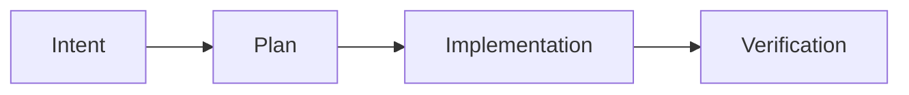
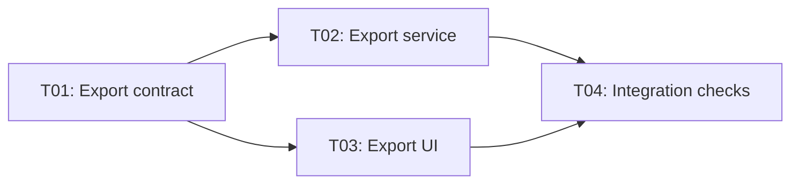

# SpecFlow

**SpecFlow is a skill-first development protocol for coding agents.**

[中文说明](README.zh-CN.md)

The agent develops the software; SpecFlow organizes the intent, plan, implementation, verification, and delivery review.

## Workflow

Every task follows the same four stages:



| Stage | Required result |
| --- | --- |
| Intent | Goals, scope, scenarios, constraints, and acceptance criteria, with unclear requirements resolved through discussion |
| Plan | Completed investigation, technical decisions, development and check arrangements, including every subtask's design |
| Implementation | Work performed against the accepted plan, with changes and check evidence recorded |
| Verification | Deviations explained and fixed, with recheck evidence for overall acceptance and integration |

A stage advances when its work is complete and your authorization covers the next stage. New requirement ambiguities or design gaps return affected work to Intent or Plan. Ordinary local coding choices can be made during implementation.

Small changes keep concise intent, plan, and verification records. Larger work shares those parent records and adds one task document per subtask. The agent decides whether to split based on deliverables, responsibilities, review needs, and coordination costs; each task has one main result and checkable acceptance criteria.

## Install

Development from a checkout requires Python 3.12+, `uv`, GNU Make, and bash. On Windows, use an environment such as Cygwin.

Sync locked dependencies, install the editable CLI, and synchronize the native plugin:

```bash
make deps
make install
```

The plugin contains the skill, templates, and coordination reference under `plugins/specflow/skills/specflow/`. Synchronization uses the local Claude Code, Codex, or Grok Build plugin mechanism.

To install the CLI from a wheel, replace the path and version with your actual file:

```bash
uv tool install "/path/to/specflow-<version>-py3-none-any.whl"
```

The wheel includes five document templates. Native plugin synchronization is handled separately by `make install`.

## Use

Start with the [coding-agent skill](plugins/specflow/skills/specflow/SKILL.md), such as `/specflow` in Claude Code. Describe the change and the stage you want to enter:

```text
Use /specflow: add report export. Start Intent and assess whether the work needs task decomposition.
```

Review the intent, then request the plan:

```text
Accepted, start Plan.
```

Review the complete development plan, then start implementation:

```text
Confirmed, start Implementation.
```

For split work, you can specify `Start T01 in this conversation.` Accepting the parent plan accepts its covered task schemes; execution follows the scope you authorize.

After reviewing the implementation summary and checks, request overall verification:

```text
The implementation looks acceptable; start Verification.
```

Verification includes fixing implementation deviations from the accepted intent, plan, and tasks. The agent explains each deviation, immediately fixes it, and reruns affected checks under the existing verification authorization. It returns to Intent or Plan when the agreed requirements or design need clarification or change; unresolved blockers are reported with their impact and resolution conditions. An explicit read-only review request limits work to inspection.

Existing decisions and valid authorization carry forward. You can authorize several stages together; the agent completes their prerequisites and reports the implementation result before overall Verification. Verification delivery includes the corrections, recheck evidence, and a suggested commit message; Git writes require your authorization.

## Work across conversations

One coordinating conversation maintains the plan and reviews deliveries. By default, you transfer its handoff prompts to visible, independent conversations. Subagents use the same records when you explicitly choose them.

For example, each arrow below means the later task needs the earlier delivery:



All task designs are settled during Plan. Before assigning T02 or T03, the coordinator checks that T01's delivery has passed the required checks, been reviewed and accepted, and is available in the downstream baseline.

Request a handoff:

```text
Assign T02 to export-service-session and prepare a prompt I can paste into another conversation. Authorize Implementation only.
```

The coordinator records the assignment before producing the prompt. The prompt connects the authoritative plan, task, user authorization, baseline, and writable reporting location; generating it does not launch an executor.

1. Paste the prompt into the chosen conversation. The executor checks the current records and writes a receipt before changing product files.
2. The executor records progress and blockers, then writes delivery evidence before announcing completion.
3. Relay its receipt, coordination, and delivery summaries to the coordinator. The coordinator reads the records, updates execution states, and reviews deliveries before releasing dependencies.

Writing a document does not notify another conversation. A valid receipt allows work within existing authorization while the registry catches up. The coordinator owns assignments and execution states; executors report facts, and a task's Draft / Accepted status refers to its scheme.

Small tasks use receipt, progress, and delivery sections in the existing plan, without extra task documents or a registry. See the [coordination contract](plugins/specflow/skills/specflow/references/task-coordination.md) for assignment, worktree, and reassignment rules, and the [handoff template](plugins/specflow/skills/specflow/template/handoff.md) for the prompt fields.

## CLI

```bash
specflow init
specflow status
```

- `init` creates `docs/` and fills missing templates in `.specflow/template/`: intent, plan, verification, task, and handoff. Existing files are preserved; feature records are created by the agent.
- `status` reports intent, plan, and verification documents, recognizing English and canonical bilingual review headings. Task assignments are recorded in the parent plan.

Discovery supports stage directories, flat feature-stage filenames, and feature directories, using the first matching layout in that order.

## Documents

The first three records are shared by every change; task records are added when work is split:

```text
docs/intent/<yyyymmdd>-<feature>.md
docs/plan/<yyyymmdd>-<feature>.md
docs/verification/<yyyymmdd>-<feature>.md
docs/task/<yyyymmdd>-<feature>/<task-id>-<topic>.md
```

Technical design belongs in the plan or task. Task records also hold receipt, progress, checks, and delivery evidence. New schemes use Draft / Accepted; historical `docs/spec`, old templates, and customized files are retained. Re-running `init` preserves existing templates, so compare customizations with the current [templates](plugins/specflow/skills/specflow/template) when updating them.

## Development

Run quality checks and tests:

```bash
make check
make test
```

Collect coverage:

```bash
make test cov=1
```

Build source and wheel distributions:

```bash
make release
```

The release workflow installs the wheel in an isolated environment and checks `init` and `status` outside the repository.

## License

SpecFlow is released under the [MIT License](LICENSE).
