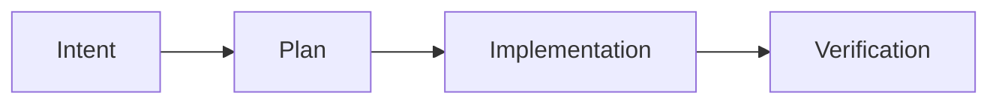
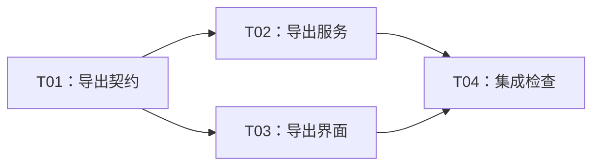

# SpecFlow

**SpecFlow 是面向 coding agent 的 skill-first 开发流程协议。**

[English README](README.md)

SpecFlow 为 coding agent 提供可审查的软件变更流程：明确意图、制定计划、实施变更并验证结果。agent 负责实际开发，SpecFlow 定义文档、阶段边界和协作规则。

## 统一流程

所有任务都经过意图、计划、实现、验证四个阶段：



复杂度只决定是否增加 task 文档。小任务保留意图、计划和验证记录，内容简明填写；大任务共享这些父级文档，每个子任务增加一份 task。技术设计写在计划或对应 task 中。

agent 会评估交付结果、职责影响、未知项、检查范围、审查上下文和协调成本。每个子任务应有一个主要结果、明确范围和可检查的验收要求。文件数、代码行数和预计时间只作提醒，不作为统一拆分硬阈值。高风险的小改动可以加强设计与检查；影响边界的方案尚未明确时，可以先安排调查任务。

## 安装

从仓库开发需要 Python 3.12+、`uv`、GNU Make 和 bash。Windows 可使用提供 Make 与 bash 的 Cygwin 等环境。

同步锁定的开发依赖：

```bash
make deps
```

将 editable CLI 安装到用户级工具目录，并同步原生 plugin：

```bash
make install
```

原生 plugin 的 skill、模板和协作参考位于 `plugins/specflow/skills/specflow/`。`install` target 通过 Claude Code、Codex 或 Grok Build 的本地 plugin 机制完成预检和同步。

也可以从构建出的 wheel 安装 CLI。将路径和版本替换为实际 wheel：

```bash
uv tool install "/path/to/specflow-<version>-py3-none-any.whl"
```

wheel 包含 CLI 使用的五份文档模板。原生 agent plugin 的同步另由仓库的 `make install` target 处理。

## 使用

从 [coding-agent skill](plugins/specflow/skills/specflow/SKILL.md) 开始，例如 Claude Code 中的 `/specflow`。用自然语言说明需要的变更和希望进入的阶段。

### 明确意图并制定计划

先讨论目标、约束、示例和边界情况。准备好后开始意图：

```text
使用 /specflow：新增报表导出功能。开始 Intent，并评估是否需要拆分 task。
```

agent 记录意图、工作量评估以及候选任务和依赖，并指出假设、风险和未决问题。只要求开始意图时，先形成意图草稿供审查；后续阶段按你的授权推进。

接受意图并开始计划：

```text
接受，开始 Plan。
```

计划记录技术选择、实施步骤、修改文件和检查方式。需要拆分时，主会话同时建立子任务文档、依赖图（DAG）、任务定义表和执行登记表。总计划成为可执行依赖与任务分配的权威来源。

### 实施

接受计划并开始实现：

```text
确认，开始 Implementation。
```

已拆分的任务也可以明确指定节点：

```text
在当前会话开始 T01。
```

接受总计划时，其覆盖的子任务方案一并接受；实际执行仍以你授权的任务范围和阶段为准。agent 沿用已有授权并记录剩余假设，不反复索取相同确认。

### 跨会话协作

一个主会话负责整理拆分并审查交付。默认由它输出提示词，你将提示词粘贴到独立可见会话，随时查看进展并直接与执行者交流。你明确选择子 agent 时，也使用相同规则。

例如，报表导出功能可以采用以下 DAG；箭头表示后一个任务需要前一个任务的交付：



分配 T02 或 T03 前，主会话核对 T01 已交付约定结果，必要检查通过或有明确的不适用依据，交付已被审查接受，且版本可用于下游工作基线。每个任务自身还需方案已接受、执行获授权、尚未分配、没有未解决冲突。提交待审查或执行者自报完成都不足以放行。

条件满足后，可以要求交接：

```text
将 T02 分配给 export-service-session，生成可复制到其他会话的提示词，仅授权 Implementation。
```

主会话先登记执行者、唯一分配编号、方案修订、基线和授权范围，再输出提示词。只要求提示词时，完成登记和提示词即可，不会自动启动会话或子 agent。

1. 将提示词粘贴到选定会话。执行者核对权威计划、分配编号、前置条件和基线，在自己的 task 文档记录接收。
2. 执行者完成授权范围，记录进展、阻塞、实际变更、交付版本、检查和风险。范围膨胀或共享契约变化时，交回主会话协调方案。
3. 让主会话审查任务记录及实际变更。它更新执行登记，只有接受可用交付后才放行依赖。

执行登记使用 `unassigned`、`assigned`、`running`、`submitted`、`accepted`，分别表示未分配、已分配、执行中、待审查、交付已接受。它们与方案的 `Draft` / `Accepted` 审查状态分别记录；交付退回返工时回到 `running`。

只有主会话更新总计划中的分配和仲裁记录，执行者在各自 task 中回报。竞争请求由主会话顺序处理。这是依赖参与者遵守规则的单一写入者约定，Markdown 不提供原子锁或自由抢任务能力。

使用多个 worktree 时，指定一处所有会话可访问的权威协调位置；分支上的计划副本不能授予新的执行权。没有依赖的任务也需检查共享文件冲突，约定隔离或串行方式以及集成责任。

重新分配前，主会话核实原执行者已停止或协调剩余共享修改，撤销旧编号并保留历史。超时本身不能证明工作已停止。旧编号的迟到交付，以及受上游变更影响的下游结果，都需要重新审查。

小任务可以直接引用已有意图和计划交接，写清授权阶段、范围和基线，不因交接额外建立 task 或分配表。完整字段见[协作文档契约](plugins/specflow/skills/specflow/references/task-coordination.md)和[交接提示词模板](plugins/specflow/skills/specflow/template/handoff.md)。

### 验证整体结果

子任务检查和交付审查用于判断依赖是否满足。整体 Verification 检查集成、有效交付版本、实际 diff 和全部父级验收标准。

看过实现摘要、检查、风险和范围变化后，可以要求验证：

```text
实现看起来可以接受，开始 Verification。
```

如果你授权连续完成实现和验证，agent 会先展示实现摘要与验证前风险，再进入 Verification。建议 commit message 在 Verification 后提供；Git 写操作需要你的授权。

## CLI

CLI 用于初始化和诊断：

```bash
specflow init
specflow status
```

- `init` 创建 `docs/`，将 `intent.md`、`plan.md`、`verification.md`、`task.md`、`handoff.md` 复制到 `.specflow/template/`。它补充缺失模板并保留已有文件，不自动建立功能或任务记录。
- `status` 报告每个功能的 `intent`、`plan`、`verification` 文档，识别英文和规范双语审查标题。task 与交接提示词属于辅助文档，不作为阶段列或独立功能发现。任务分配仍在总计划中查看。

保留三种既有文档布局：阶段目录、平铺的功能与阶段文件名、功能目录。发现时按此顺序选择首个包含匹配文档的布局。新文档使用下述阶段目录。

## 文档

大小任务都共享以下父级文档：

```text
docs/intent/<yyyymmdd>-<feature>.md
docs/plan/<yyyymmdd>-<feature>.md
docs/verification/<yyyymmdd>-<feature>.md
```

需要拆分时增加：

```text
docs/task/<yyyymmdd>-<feature>/<task-id>-<topic>.md
```

每个 task 记录局部设计、实施安排、接收与进展、检查和交付证据，沿用父级流程，不重新建立整套阶段文档。总计划通过稳定 ID 关联任务，维护权威依赖与分配。

新方案只使用 `Draft` 和 `Accepted`。已有 `docs/spec` 记录、旧 `spec.md` 模板和定制文件作为历史资料保留；新任务的技术设计写在计划或 task 中。重复运行 `init` 不会迁移已有模板，更新旧定制时应对照当前[模板](plugins/specflow/skills/specflow/template)审查调整。

## 开发

运行项目检查：

```bash
make check
```

运行单元测试，或生成覆盖率：

```bash
make test
make test cov=1
```

构建 source 和 wheel distributions：

```bash
make release
```

发布 workflow 还会在隔离环境安装 wheel，并在仓库外检查 `init` 与 `status`，验证包内模板可用。

## 许可证

SpecFlow 使用 [MIT License](LICENSE) 开源。
