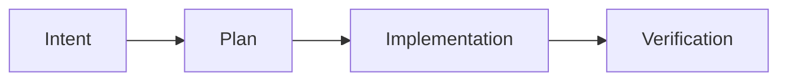
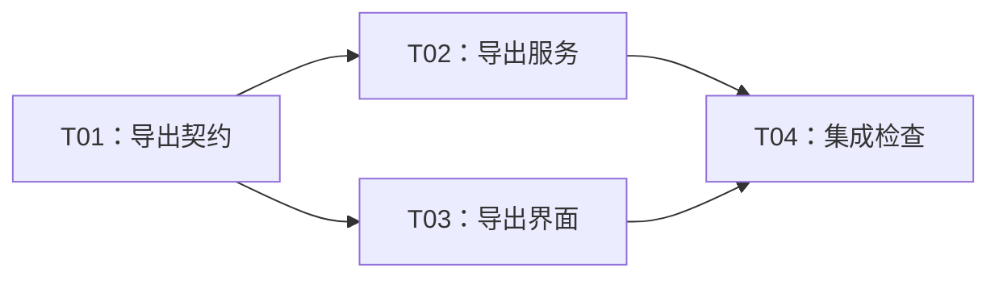

# SpecFlow

**SpecFlow 是面向 coding agent 的 skill-first 开发流程协议。**

[English README](README.md)

agent 负责软件开发，SpecFlow 组织意图、计划、实现、验证和交付审查。

## 统一流程

所有任务采用相同的四阶段流程：



| 阶段 | 应完成的结果 |
| --- | --- |
| Intent | 目标、范围、场景、约束与验收，不明确的需求已沟通确认 |
| Plan | 调查结论、技术选择、开发与检查安排，包括全部 task 的局部设计 |
| Implementation | 按已接受方案实施，记录变更和检查证据 |
| Verification | 偏差已说明并修复，以复验证据确认整体验收与集成结果 |

阶段工作完成且授权覆盖后续阶段时才推进。新出现的需求疑问或设计缺口使受影响工作回到 Intent 或 Plan；普通局部代码写法可在实现时决定。

小任务保留简明的意图、计划和验证记录；大任务共享父级记录，每个子任务增加一份 task。agent 根据交付结果、职责、审查需要和协调成本判断是否拆分，每个 task 有一个主要结果和可检查的验收。

## 安装

从仓库开发需要 Python 3.12+、`uv`、GNU Make 和 bash。Windows 可使用 Cygwin 等环境。

同步锁定的依赖，安装 editable CLI 并同步原生 plugin：

```bash
make deps
make install
```

plugin 的 skill、模板和协作参考位于 `plugins/specflow/skills/specflow/`，通过 Claude Code、Codex 或 Grok Build 的本地 plugin 机制同步。

也可从 wheel 安装 CLI，将路径和版本替换为实际文件：

```bash
uv tool install "/path/to/specflow-<version>-py3-none-any.whl"
```

wheel 包含五份文档模板，原生 plugin 另由 `make install` 同步。

## 使用

从 [coding-agent skill](plugins/specflow/skills/specflow/SKILL.md) 开始，例如 Claude Code 中的 `/specflow`。说明需要的变更和希望进入的阶段：

```text
使用 /specflow：新增报表导出功能。开始 Intent，并评估是否需要拆分 task。
```

审查意图后开始计划：

```text
接受，开始 Plan。
```

审查完整开发方案后开始实现：

```text
确认，开始 Implementation。
```

已拆分的任务可以指定“在当前会话开始 T01”。接受总计划时，其覆盖的 task 方案一并接受；执行仍按你的授权范围。

看过实现摘要与检查结果后，开始整体验证：

```text
实现看起来可以接受，开始 Verification。
```

Verification 包含修复实现与已接受意图、计划和 task 的偏差。agent 先说明偏差，随即沿用验证授权修复并复验受影响检查；既定需求或方案需要澄清、变更时才回到 Intent 或 Plan，无法解决的阻塞说明影响和解除条件。明确要求只读审查时，仅进行检查。

已有决策与有效授权可以沿用。你可以授权连续完成多个阶段，agent 仍需完成相应前置工作，并在整体 Verification 前汇报实现结果。验证交付包含修复、复验证据和建议 commit message，Git 写操作需要你的授权。

## 跨会话协作

主会话维护总计划并审查交付，默认由你将交接提示词转交独立可见会话。你明确选择子 agent 时，使用相同记录。

例如，下图箭头表示后一个任务需要前一个任务的交付：



全部 task 设计在 Plan 内确定。分配 T02 或 T03 前，主会话核对 T01 的交付已通过必要检查、被审查接受，且可用于下游基线。

要求交接：

```text
将 T02 分配给 export-service-session，生成可复制到其他会话的提示词，仅授权 Implementation。
```

主会话先登记分配再输出提示词，连接权威计划、task、用户授权、基线和可写回报位置；生成提示词不启动执行者。

1. 将提示词粘贴到选定会话。执行者核对当前记录，在产品修改前写入接收记录。
2. 执行者记录进展和阻塞，宣布完成前写入交付证据。
3. 将接收、协调和交付摘要转交主会话，由它读取记录、更新执行状态、审查交付后放行依赖。

写入文档不会通知其他会话；有效接收落盘后可按已有授权工作，总登记随后同步。主会话维护分配和执行状态，执行者回报事实，task 的 Draft / Accepted 只表示方案状态。

小任务使用已有计划中的接收、进展和交付章节，不额外建立 task 或登记表。分配、worktree 和重新安排规则见[协作契约](plugins/specflow/skills/specflow/references/task-coordination.md)，提示词字段见[交接模板](plugins/specflow/skills/specflow/template/handoff.md)。

## CLI

```bash
specflow init
specflow status
```

- `init` 创建 `docs/`，在 `.specflow/template/` 中补充意图、计划、验证、task 和 handoff 五份模板。已有文件保留，功能记录由 agent 创建。
- `status` 报告意图、计划和验证文档，识别英文和规范双语审查标题。任务分配在总计划中查看。

发现顺序为阶段目录、平铺的功能与阶段文件名、功能目录，使用首个匹配布局。

## 文档

所有变更共享前三类记录，拆分时增加 task：

```text
docs/intent/<yyyymmdd>-<feature>.md
docs/plan/<yyyymmdd>-<feature>.md
docs/verification/<yyyymmdd>-<feature>.md
docs/task/<yyyymmdd>-<feature>/<task-id>-<topic>.md
```

技术设计写在计划或 task，task 同时记录接收、进展、检查和交付证据。新方案使用 Draft / Accepted，历史 `docs/spec`、旧模板与定制文件保留。重复运行 `init` 会保留已有模板，更新定制时需对照当前[模板](plugins/specflow/skills/specflow/template)。

## 开发

运行质量检查与测试：

```bash
make check
make test
```

生成覆盖率：

```bash
make test cov=1
```

构建 source 和 wheel distributions：

```bash
make release
```

发布 workflow 在隔离环境安装 wheel，并在仓库外检查 `init` 和 `status`。

## 许可证

SpecFlow 使用 [MIT License](LICENSE) 开源。
