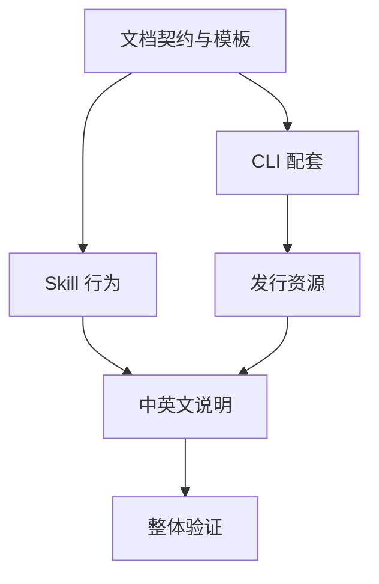

# Plan / 计划：工作量评估、DAG 拆分与多会话协作
最后修改时间: 2026-10-10 22:52:31

## Review status / 审查状态

Accepted

## Workflow / 流程

Intent / 意图 → Plan / 计划 → Implementation / 实现 → Verification / 验证

## Intent basis / 意图依据

依据已接受并按最新讨论更新的[总意图](../intent/20261009-workload-aware-task-decomposition.md)。统一为意图、计划、实现、验证；任务复杂度只决定是否增加 task。技术设计在计划或 task 内表达，不再引入独立 Spec 阶段和流程模式名称。

当前阶段为 Verification，检查已执行完毕。本轮接受 T05，并完成 T06 整体验证、项目检查和发行 smoke；[总验证报告](../verification/20261009-workload-aware-task-decomposition.md)已提交，待用户审查。Make / bash 检查使用已确认可用的 cygwin.bat。

## Coordination / 协调信息

- 方案修订：1；任务边界、依赖或验收要求变化时递增，执行登记更新不单独递增。
- 权威协调根：D:/SourceCodes/mywork/SpecFlow。
- 仲裁会话：当前主会话 / root。
- 本轮阶段授权：Verification，T06；依据用户在 T05 实现交付、风险和下一步说明后要求“继续推进”。

## Repository findings / 仓库现状

- 协议入口在 plugins/specflow/skills/specflow/SKILL.md，现有模板为 intent、spec、plan、verification；需移除新流程中的模式选择与独立 Spec，并增加辅助模板。
- src/specflow/cli.py 共用 PROTOCOL_FILES 表示阶段和初始化模板。新增辅助模板时需分离这两个概念，避免 task / handoff 成为流程阶段。
- CLI 的 _review_status 仅识别英文标题，现有模板和新文档使用双语标题，可能将 Accepted / Draft 显示为 present。
- _template 依赖源码仓库内的 plugins 路径，pyproject.toml 未显式配置模板资源进入 wheel；现有发行 smoke test 只覆盖 import 和 --help，需补充仓库外 init 检查。
- scripts/install.py 是通用原生插件同步引擎，项目配置已指向整个 plugins/specflow 包。新增 skill 资源应通过现有包交付，不把任务调度加入该引擎。
- 项目使用 Python 3.12+、uv、Ruff、mypy、pytest、Hatchling；公共检查入口为 Makefile。
- 梳理时基线为 develop / 9323169。后续派发需记录实际工作基线，不能把此历史基线当成永久执行依据。

## Workload and decomposition / 工作量与拆分依据

本次包含文档契约、模型行为、CLI 初始化、发行资源和使用说明等可分别 review 的交付，跨文档与 Python 实现，不能作为一个不设边界的整体修改任务。

拆为六个节点。T01 的模板共享同一协作契约，集中维护以避免字段漂移；T02 与 T03 在 T01 接受后拥有不同修改范围，可并行。T04 接续 T03 处理发行资源，避免同时修改 CLI 和测试。T06 是整体 Verification 节点，需要对应阶段授权。

每项预计变更范围和未知项见对应子任务。实施中若发现节点仍过粗，由主会话更新此计划和相关任务后再扩大范围。

## Document contract / 文档契约

### 路径与职责

- 统一流程为 Intent → Plan → Implementation → Verification。阶段文档为 docs/intent、docs/plan、docs/verification 中的同名记录；Implementation 是实际开发。
- 小任务也保留意图、计划和验证，只调整内容篇幅；复杂度只决定是否增加 task，不改变阶段。
- 子任务路径采用 docs/task/<yyyymmdd>-<feature>/<task-id>-<topic>.md；它们是父任务的辅助文档，不作为独立 feature 或新阶段。
- 技术设计及局部实施安排写入总计划或对应 task，不依据复杂度再创建独立 Spec 或多套阶段文档。
- 历史 docs/spec、已有 spec.md 及旧模式字段保留为历史资料，不参与新流程选择，也不由 init 自动删除。
- 总意图保留工作量、边界和初始依赖分析；进入 Plan 后，本计划的任务定义及直接依赖是执行依据，DAG 图与执行批次由它表达。
- 分配归属、有效编号、执行基线和仲裁结果只由主会话更新总计划。执行者在自己的任务文档记录接收、进展、证据和交付；主会话读取后更新总登记。
- 跨 worktree 的权威协调位置在派发时明确，不能从各分支的计划副本取得新的执行权。

### 统一计划表

为控制表格宽度，采用两个由任务 ID 关联的固定表：

1. 任务定义表：ID、任务文档、直接前置任务及交付要求、预期结果 / 验收、验收标准归属。
2. 执行登记表：ID、执行状态、执行者、分配编号、工作基线 / 交付位置、仲裁结论 / 阻塞原因。

详细约束和证据在任务文档中，表格引用它们；不能在多个位置重复维护任务归属。必要时在总计划增加分配历史，记录撤销、重新分配、旧编号和原因。

阶段文档 Review status 继续为 Draft / Accepted。任务执行状态使用 unassigned、assigned、running、submitted、accepted，分别表示未分配、已分配、执行中、待 review、交付已接受。交付被要求返工时返回 running；撤销分配后返回 unassigned，并保留旧记录。

总计划被用户接受时，覆盖的子任务方案一起接受，由主会话同步对应文档的 Review status；方案接受与实现交付接受分别记录。

### 派发与依赖放行

派发前检查：本计划与任务方案已接受、当前阶段获授权、任务未分配、全部直接前置交付已被主会话接受且可访问、没有未解决阻塞或写入冲突。

可分配结论按事实重新计算。前置交付的最低条件为约定实现 / 产物已提交、必要检查通过、仲裁 review 接受、交付版本能用于下游基线；不能只依据执行者的完成声明。

用户要求派发后，主会话先登记执行者、唯一分配编号、实际基线和授权阶段，再根据 handoff 模板输出提示词。新会话核对这些信息后，在任务文档记录接收和进展。提示词生成仅安排责任，不自动启动会话。

提示词包含权威记录和任务路径、任务 / 分配编号、授权范围与阶段、前置交付版本、共享修改约束、检查和回报方式。新会话可以与用户直接交流；影响全局边界与依赖时回报主会话协调。

首版以单一仲裁写入者提供协作约定，不新增 claim / next 等 CLI 写入命令，不宣称原子互斥。需要自由抢任务时另行设计原子操作。

### 开发检查与整体验证

子任务在 Implementation 内运行与改动相关的必要检查并提交证据，主会话据此 review 和放行依赖。这不是自动进入整体 Verification 的授权。

T01 至 T05 实现完成后，主会话汇报实际 diff、检查、风险与范围偏差。默认由用户明确开始 Verification 后再执行 T06；用户在后续消息明确要求连续实现和验证时，也按现有阶段规则处理。

## Task definitions / 任务定义表

| ID | 任务文档 | 直接前置任务与要求 | 预期交付与验收 | 意图验收归属 |
| --- | --- | --- | --- | --- |
| T01 | [文档契约与模板](../task/20261009-workload-aware-task-decomposition/T01-document-contract.md) | 无；需计划及开发阶段授权 | 固定表格、任务和提示词模板、协作参考；例子能表达规模、依赖、分配和交付 | A01–A09 |
| T02 | [Skill 行为与阶段衔接](../task/20261009-workload-aware-task-decomposition/T02-skill-workflow.md) | T01；契约经 review 接受且资源可读取 | 统一四阶段、复杂度仅决定 task、主会话仲裁与可见会话交接 | A01–A09 |
| T03 | [CLI 模板与状态](../task/20261009-workload-aware-task-decomposition/T03-cli-support.md) | T01；辅助模板与审查标题已确定且可读取 | init 提供五份模板；status 报告三类阶段文档，识别双语标题并保留既有布局 | A10 |
| T04 | [发行资源与安装边界](../task/20261009-workload-aware-task-decomposition/T04-resource-delivery.md) | T03；CLI 修改与检查已接受，可在基线上使用 | 干净 wheel 安装后可 init；原生 plugin 包引用全部资源，无新增发现来源 | A11 |
| T05 | [中英文使用说明](../task/20261009-workload-aware-task-decomposition/T05-user-guidance.md) | T02、T04；协议行为与发行方式已接受 | 两种语言说明统一流程、是否建立 task、派发、依赖和并发边界，示例与实际一致 | A02、A06、A11 |
| T06 | [集成与整体验证](../task/20261009-workload-aware-task-decomposition/T06-integration-verification.md) | T05；其上游交付也有效，且用户授权 Verification | 核对全部验收、集成、既有检查及发行行为，形成总验证记录 | A01–A12 |

## Execution registry / 执行登记表

T01 至 T05 已接受，T06 已提交整体验证报告。unassigned 只表示未分配，不能绕过阶段授权或前置条件。

| ID | 执行状态 | 执行者 | 分配编号 | 工作基线 / 交付位置 | 仲裁结论 / 当前阻塞 |
| --- | --- | --- | --- | --- | --- |
| T01 | accepted | 当前会话 / root | T01-7ffdca45fef046b78bf269d520b14903 | 9323169 + 已接受的当前工作区过程文档 / 本协调根工作区，T01-docs-20261010-212919；资源哈希见 T01 交付记录 | 主会话核对契约、检查证据与六份资源哈希后接受；可作为 T02 / T03 的前置交付 |
| T02 | accepted | 当前会话 / root | T02-7321269a8e8a40f48b846a0394cc317f | 9323169 + T01-docs-20261010-212919 + 已接受的过程文档 / 本协调根工作区，T02-skill-20261010-214428；哈希见 T02 交付记录 | 主会话复核 skill、前置契约、文档走查与哈希后接受；可作为 T05 的前置之一 |
| T03 | accepted | 当前会话 / root | T03-9e22750a973d43249d0e670dd901377d | 9323169 + 已接受的 T01 / T02 交付及过程文档 / 本协调根工作区，T03-cli-20261010-215438；版本见 T03 交付记录 | 主会话复核代码、模板删除、23 项测试与质量检查证据及哈希后接受；供 T04 使用 |
| T04 | accepted | 当前会话 / root | T04-4c9b7cec6fbc4f49bb5687978251d591 | 9323169 + 已接受的 T01 至 T03 交付及过程文档 / 本协调根工作区，T04-resources-20261010-220700；文件与产物哈希见 T04 | 主会话复核资源实现、源码 / editable / wheel 与插件检查证据及文件 / 产物哈希后接受；供 T05 使用 |
| T05 | accepted | 当前会话 / root | T05-1c5ab7998e304afaaa535b520085f376 | 9323169 + 已接受的 T01 至 T04 交付及过程文档 / 本协调根工作区，T05-guidance-20261010-224033；两份 README 哈希见 T05 | 主会话核对双语文档、产品行为、检查证据和哈希后接受；供 T06 使用 |
| T06 | submitted | 当前会话 / root | T06-c0f0280c10624162be36a1a97b44748b | 9323169 + 已接受的 T01 至 T05 交付及过程文档 / 本协调根工作区，T06-verification-20261010-225231；报告与产物哈希见 T06 | A01–A12 本地约定验收、27 项测试、质量检查、构建及仓库外 smoke 通过；报告 Draft 待用户审查 |

## Assignment history / 分配历史

| 时间 | ID | 分配编号 | 执行者 | 授权与动作 |
| --- | --- | --- | --- | --- |
| 2026-10-10 21:17:31 | T01 | T01-7ffdca45fef046b78bf269d520b14903 | 当前会话 / root | 用户要求开始 T01；登记分配并接收，进入 Implementation |
| 2026-10-10 21:29:19 | T01 | T01-7ffdca45fef046b78bf269d520b14903 | 当前会话 / root | 提交 T01-docs-20261010-212919，记录六份资源哈希、走查和检查证据；等待审查，不分配下游 |
| 2026-10-10 21:38:47 | T01 | T01-7ffdca45fef046b78bf269d520b14903 | 当前会话 / root | 用户要求推进下一步；主会话复核契约、检查证据及六份资源哈希后接受交付 |
| 2026-10-10 21:38:47 | T02 | T02-7321269a8e8a40f48b846a0394cc317f | 当前会话 / root | 按顺序登记分配并接收；基于已接受 T01 进入 T02 Implementation |
| 2026-10-10 21:44:28 | T02 | T02-7321269a8e8a40f48b846a0394cc317f | 当前会话 / root | 提交 T02-skill-20261010-214428，记录 skill 哈希、六个场景走查及结构和引用检查；等待审查 |
| 2026-10-10 21:50:17 | T02 | T02-7321269a8e8a40f48b846a0394cc317f | 当前会话 / root | 用户要求继续推进；复核 skill 契约、走查、检查证据及哈希后接受交付 |
| 2026-10-10 21:50:17 | T03 | T03-9e22750a973d43249d0e670dd901377d | 当前会话 / root | 登记分配并接收 T03 Implementation；直接前置 T01 的六份资源哈希已复核 |
| 2026-10-10 21:54:38 | T03 | T03-9e22750a973d43249d0e670dd901377d | 当前会话 / root | 提交 T03-cli-20261010-215438，记录代码与测试哈希、模板删除和检查证据；等待审查 |
| 2026-10-10 21:59:35 | T03 | T03-9e22750a973d43249d0e670dd901377d | 当前会话 / root | 用户要求继续推进；复核代码、测试证据、哈希与模板删除后接受交付 |
| 2026-10-10 21:59:35 | T04 | T04-4c9b7cec6fbc4f49bb5687978251d591 | 当前会话 / root | 登记分配并接收 T04 Implementation；使用隔离构建及安装环境验证发行资源 |
| 2026-10-10 22:07:00 | T04 | T04-4c9b7cec6fbc4f49bb5687978251d591 | 当前会话 / root | 提交 T04-resources-20261010-220700，记录资源构建与读取、CI smoke、插件引用及三种本地运行方式检查；等待审查 |
| 2026-10-10 22:31:57 | T04 | T04-4c9b7cec6fbc4f49bb5687978251d591 | 当前会话 / root | 用户要求继续推进；复核四份产品文件与两份产物哈希及检查证据后接受交付 |
| 2026-10-10 22:31:57 | T05 | T05-1c5ab7998e304afaaa535b520085f376 | 当前会话 / root | 登记分配并接收 T05 Implementation；直接前置 T02 / T04 已核对 |
| 2026-10-10 22:40:33 | T05 | T05-1c5ab7998e304afaaa535b520085f376 | 当前会话 / root | 提交 T05-guidance-20261010-224033，记录中英文说明、链接与对应性检查及文件哈希；等待审查，T06 未分配 |
| 2026-10-10 22:46:20 | T05 | T05-1c5ab7998e304afaaa535b520085f376 | 当前会话 / root | 用户要求继续推进；主会话复核说明、检查证据及两份文件哈希后接受 |
| 2026-10-10 22:46:20 | T06 | T06-c0f0280c10624162be36a1a97b44748b | 当前会话 / root | 登记分配并接收 Verification；T01 至 T05 当前有效产品交付及既有 T04 产物哈希已核对 |
| 2026-10-10 22:52:31 | T06 | T06-c0f0280c10624162be36a1a97b44748b | 当前会话 / root | 提交 T06-verification-20261010-225231；全部约定本地检查通过，记录验证报告与新版发行产物哈希，待用户审查整体结果 |

## DAG and batches / DAG 与执行批次

执行顺序：T01；T02 / T03 可并行；T04；T05；阶段获授权后执行 T06。不同节点通过 review 只是依赖条件之一，仍需确认交付版本可访问。

T02 与 T03 分别修改 skill 入口和 Python CLI / 测试，允许隔离工作区并行。T03 与 T04 可能修改同一资源加载代码或测试，按依赖顺序串行。总计划和分配历史由主会话维护，各执行者只写自己的任务进展与代码范围。

## Files to change / 预期产品修改

- T01：plugins/specflow/skills/specflow/template/intent.md、plan.md、verification.md；新增 task.md、handoff.md 和 references/task-coordination.md。删除新模板的模式字段与按模式区分的要求，技术设计纳入计划 / task。
- T02：plugins/specflow/skills/specflow/SKILL.md。移除模式别名、选择和独立 Spec 职责，统一四阶段；详细协作契约引用 T01 的参考文件。
- T03：src/specflow/cli.py、tests/test_cli.py，并删除 plugin 内的 template/spec.md；分离三类阶段文档与五份初始化模板清单，取消活动 spec 列，修正规范审查标题读取，覆盖初始化幂等和历史文件保留。
- T04：pyproject.toml 的资源构建配置、CLI 的资源读取及相应测试；必要时扩展 .github/workflows/release.yml 既有 wheel smoke test。新增资源继续只有一个仓库源。
- T04：审查 scripts/install.py 的配置和包校验及 tests/test_install.py；现有包路径足够时仅增加必要验证，不改通用同步引擎。若确有通用引擎缺陷，单独报告，按规范源流程处理。
- T05：README.md、README.zh-CN.md；将三模式流程图引用替换为统一流程图，说明是否增加 task 的唯一文档分支。
- T06：本功能的 docs/verification 同名文档；任务与计划中的实际交付记录。

Makefile 公共入口与客户端 marketplace 布局没有本次必要改动。旧三模式图片可以保留为历史资产，但不在新版使用说明中继续引用。发布版本与 Codex 刷新后缀在交付准备时按用户发布要求决定，不在计划阶段修改。

## Script scope / 首版脚本支持边界

交付顺序调整：旧 CLI 在 init 中读取 spec.md，T01 删除该模板会破坏初始化，因此将删除动作移到 T03，与消费者取消引用同次交付。T03 已完成该调整；用户已有模板和历史文档不在删除范围。

CLI 继续只有 init / status 两个公开命令。init 初始化 intent.md、plan.md、verification.md、task.md、handoff.md 五份模板，不自动创建任务过程文档；status 报告 intent、plan、verification 三类父级阶段文档，Implementation 不要求独立文档，辅助模板不参与阶段发现。

新初始化不生成 spec.md，status 不再输出活动 spec 列。已有 docs/spec 和 .specflow/template/spec.md 不由脚本删除；三个保留阶段的三种既有布局继续可用。这是明确的流程输出调整，需在测试和使用说明中核对。

任务表、DAG 合法性与可分配条件由主会话按照固定契约检查。首版不新增 Markdown 表格解析依赖、任务状态数据库、自动派发或自由认领命令。若使用过程中需要确定性校验工具，再依据实际格式与失败案例做独立增量。

发行资源使用仓库模板作为唯一源，通过 Hatch 构建映射进入包资源；CLI 用结构化资源 API 读取安装包中的模板，并验证 editable / 源码工作区的同源读取方式。T04 以仓库外 init 的实测决定是否需要局部资源加载调整。

scripts/install.py 继续同步原生 plugin 包；新参考和模板包含在同一 skill 目录，不另建用户级镜像。真实刷新安装状态属于交付操作，本计划只安排隔离检查，不在本轮执行。

## Verification plan / 验证计划

### 行为与文档

- 小任务：不拆分，说明依据，无独立 task；仍经过意图、计划、实现和验证，保留三类阶段记录。
- 大任务：目标、验收与 DAG 对齐，所有节点、引用、直接依赖和归属完整，无环。
- 流程统一：新 skill、模板、示例和 CLI 不再要求选择模式或进入 Spec；技术设计在计划 / task 内表达，历史记录不被误判为活动流程要求。
- 放行：上游提交待 review 时不可分配，接受且基线可用后才可分配；上游版本变化需要重新评估。
- 仲裁：两个执行者请求同一任务时只登记一个有效分配；撤销、返工和重新分配保留历史。
- 交接：提示词只在用户要求后输出，新会话能够读取权威位置、检查编号、记录接收并提交证据。
- 并行：无依赖但共享修改范围时先协调；不同 worktree 中的计划副本不成为独立认领入口。
- 阶段：交付检查不自动触发整体 Verification；文档 Accepted 不被当作实现完成。

上述场景优先用临时样例或可见会话走查，检查产生的决策和产物，不为固定措辞建立逐字测试，也不自动启动子 agent。

### Python 与发行

- T03 运行与 init / status 行为相关的 pytest；覆盖五份模板、新 init 不生成 spec.md、重复 init 保留已有文件与历史 spec.md、status 仅报告三类阶段文档、三种既有布局，以及英文 / 双语标题的 Draft / Accepted。
- T04 构建并在隔离环境、仓库外工作目录安装 wheel，运行 init / status 并检查模板可读取；源码及 editable 方式也能读取同一模板源。
- T04 通过 JSON 解析、源路径检查或 fake runner 核对插件引用；不因测试自动写入用户 Home、缓存或真实客户端注册。
- T06 按既有入口执行 uv lock --check、make check、make test、make release，并收集 CLI 状态与安装包 smoke 结果。Windows 需已有 GNU Make + bash。
- 最终对照实际 diff 检查文件范围、验收覆盖和未完成项，形成总验证报告；有失败或未交付项时明确记录。

## Risks / blockers / assumptions / 风险、阻塞与假设

- T05 已接受，T06 验证已执行并提交报告；整体报告仍为 Draft，待用户审查。
- 文档字段与目录随本计划接受，具体契约由 T01 落实；所有必要技术选择在计划或 task 中表达，不依赖独立规格阶段。
- T02 至 T05 的产品交付及 T06 本地检查均已完成；T06 已重新构建包含新版说明的发行产物，哈希见验证报告。真实多会话并行、插件刷新与远程 CI / 发布未执行，本地构建交付不代表已安装客户端完成迁移。
- 从旧模式和四类文档输出改为统一流程、三类文档输出时，需同步 skill、CLI、测试、模板和流程图引用；新旧输出差异不能以“兼容旧模式”重新引入模式选择。
- 单一仲裁文件协议无法阻止不遵守约定的自由抢任务；不能承诺跨会话原子互斥。
- Python 资源在源码、editable 和 wheel 中的路径可能不同，需要 T04 的实际验证，不能只检查 --help。
- 用户会话的工作区可能不相同，交接必须明确权威记录及代码位置；主会话核对收到的版本后才接受。
- 发行版本尚未指定，真实插件刷新与远程发布不在本轮范围。

## Rollback / recovery / 回滚与恢复

实现按节点独立交付并由主会话集成；出现问题时在用户授权下回退相关代码 / 资源变更，保留已作出的 review 和分配历史。重新分配需撤销旧编号并明确新的基线，不能仅清空执行者记录。

新任务统一采用四阶段及三类阶段文档，只有需要拆分的任务增加 task。旧模式和 Spec 记录作为历史资料保留，不批量改写或删除；已有文件不因重新 init 被覆盖。

## User review notes / 用户审查记录

- 2026-10-10：用户要求总结讨论为 Intent，并开始计划修改本项目 skill / 脚本。
- 2026-10-10：用户要求移除严格和轻量模式，让复杂度只决定是否有 task；本计划据此统一流程、将设计纳入计划 / task，并调整 CLI、模板、测试和使用说明范围。
- 2026-10-10：用户要求开始 T01；总计划与所覆盖的六份子任务方案标记 Accepted，仅 T01 分配给当前会话实施。
- 2026-10-10：实现前发现删除 spec 模板会破坏旧 CLI init，将删除动作移至 T03 与消费者取消引用同时交付；总体目标与 DAG 不变，T01 交付时向用户说明。
- 2026-10-10：用户要求“推进下一步”；主会话审查并接受 T01，按任务顺序分配 T02 给当前会话实施。
- 2026-10-10：用户要求“继续推进”；主会话审查并接受 T02，分配 T03 给当前会话实施。
- 2026-10-10：用户继续要求推进，并补充 cygwin.bat 可用；主会话接受 T03，分配 T04，使用 Cygwin 的 Make / bash 执行适用检查。
- 2026-10-10：用户在 T04 交付后要求继续推进；主会话接受 T04，分配 T05，更新中英文使用说明。
- 2026-10-10：用户在 T05 实现摘要及下一步 T06 说明后要求继续推进；接受 T05 并进入整体 Verification。
